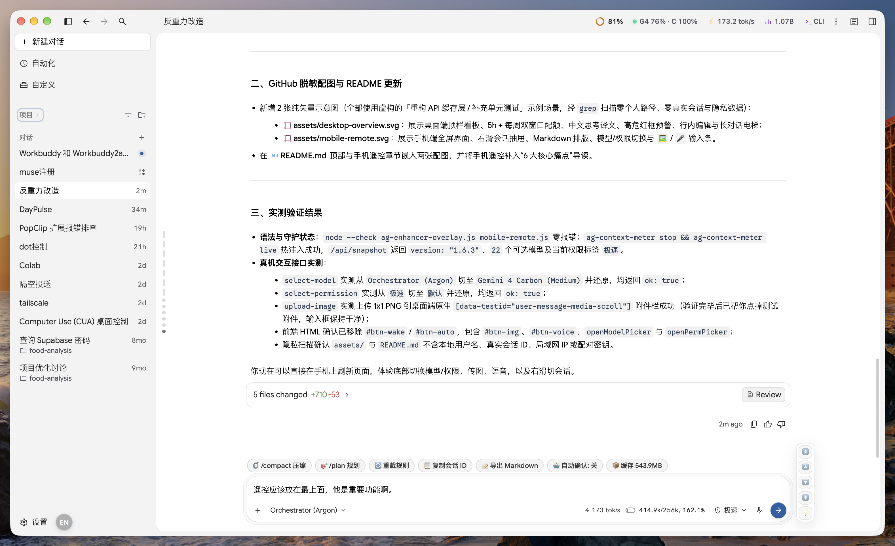
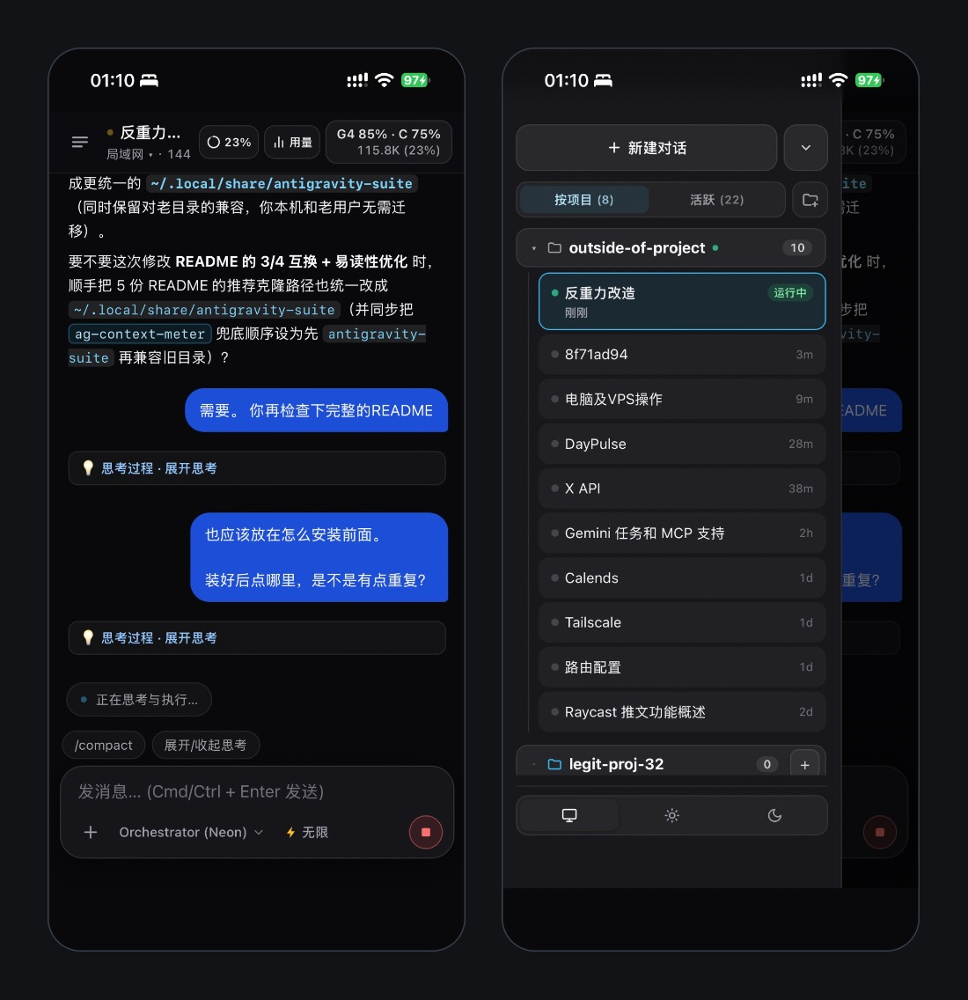

# Antigravity Suite

[简体中文](../README.md) · **English** · [日本語](README.ja.md) · [한국어](README.ko.md) · [Español](README.es.md)

> **100% zero-patch enhancement & remote control suite for Google Antigravity desktop (macOS) — never modifies `app.asar` or Apple code signatures, safe across official updates, and instant to toggle.**

<p align="center">
  
</p>

## Core Highlights

1. **🇨🇳 Instant Chinese / English UI Toggle (Zero-Token Local Thought Translation)**
   - Switch instantly between Simplified Chinese UI (+ zero-token local caching translation for Thinking blocks & titles) and original English right inside **`⚙️`**, without restarting.
2. **📱 Ultra-Fast Mobile & Desktop Remote Control (Much Faster Than Official)**
   - **Direct local speed & lightweight PWA**: Millisecond LAN direct connection with concurrent speed probing across **LAN**, **Tailscale**, **Bonjour (`*.local`)**, and a **default no-login Cloudflare Quick Tunnel (`*.trycloudflare.com`, custom domains supported)** — bypassing sluggish official cloud relays; cancels only unfinished page-refresh fetches when switching chats (never interrupts running AI tasks) and pairs lazy history loading with **`gzip`** compression for instant loading and smooth full-history upward scrolling.
   - Multi-project grouped sessions with unread/approval badges, `$HOME`-bounded remote project creation, project file tree & session diffs/artifacts preview, queued-message management (send all / delete), generic file & image uploads, interactive prompt cards (with high-risk double confirmation), top-bar drawers, 9 UI visibility toggles, per-tab session isolation (`X-AG-Client-Id`), **System / Light / Dark** appearance sync, disabled-channel `403` gates, and `Cmd/Ctrl + Enter` sending with Safari IME protection.
3. **⚡ Composer Shortcuts & Prompt Optimization**
   - **14 built-in recommended quick actions** grouped by scenario & priority + custom prompts with **10 one-click popular templates**; slash commands resolve into native Lexical pills.
   - **`Insert` vs `⚡Send`**: **`Insert`** stages text into the composer for pasting logs or context (default for *Fix Error*, *Do Spec*). **`⚡Send`** (marked `↵`) submits immediately (default for 8 argument-free phrases such as *Implement*, *Reply in Chinese*, *Continue*, *No explanation*, *Run It*, *Optimize*, *Why Failed*, *Revise*), guarded by draft protection and **`⌘/Ctrl + click`** inversion.
   - One-click **`✨ Optimize` / `↩ Undo`** via fast low-latency models and context-aware **`Tab / →`** next-step ghost suggestions.
4. **🧰 Quick Desktop Utilities**
   - **`⌘1`–`⌘9`** (hold `⌘` for badges) or **`⌘⇧[` / `⌘⇧]`** / **`⌃Tab`** to jump between conversations, floating message navigator bar, inline **`✏️ Edit`** + **`⌘S`** file editing in preview panes, and **`>_ CLI`** one-click `agy` terminal launch. Compatible with Antigravity **`2.32.x–2.34.0`**, `SingletonSocket` fast polling, and `nvm`/`fnm`/`volta`/`asdf`/`mise` Node discovery.
5. **📊 Context Window, 240K Auto-Compact & Dual Quota Capsules**
   - Live top-bar ring meter, token breakdown, 52-week heatmap, API cost comparison, and **Gemini 4 / Claude** 5-hour + weekly quota capsules (`G4` / `C`).
   - Official clients wait until 512K tokens to compact, often causing 4–5 minute full recomputation stalls after prompt cache expires past 250K–330K; real-time alerts catch 0% cache drops (328K risk), while default-enabled **240K Auto-Compact** triggers `/compact` automatically when idle.
6. **🛡️ Dangerous Command Red-Frame Interception**
   - Highlights destructive shell commands (`rm -rf`, `git reset --hard`, `git clean -f`, `git push`, `sudo`, `kill -9`, `DROP/DELETE`, `op item`) with red warning frames and pauses for manual approval even when Auto-Accept is enabled.
7. **🔄 Auto Update Check & One-Click Hot Upgrade**
   - Automatically checks GitHub in the background; when a new version is available, **`⚙️`** shows a red dot so you can click **"立即更新" (Update Now)** and hot-reload without restarting Antigravity.

<p align="center">
  
</p>

---

## 🚀 Zero-Patch Installation (macOS)

Requires **macOS**, **Google Antigravity**, and **Node.js `22.4.0+`**.

```bash
git clone https://github.com/iamvicliu/antigravity-suite.git ~/.local/share/antigravity-suite
cd ~/.local/share/antigravity-suite
./scripts/setup-macos-cdp.sh
```

> Optional flags: `--no-auto` skips installing the `LaunchAgent` auto-launcher (you can run `ag-context-meter install-launcher` to create a standalone app icon in `~/Applications`), and `--no-remote` (or `AG_DISABLE_MOBILE_REMOTE=1`) disables the remote control server.
>
> **Windows / Linux**: Start Antigravity with `--remote-debugging-port=9222` (or let CDP auto-detect), then run `node cli.js live` from the cloned directory (`node cli.js status` to check).

Add `~/.local/bin` to your shell `PATH` if needed:

```bash
echo 'export PATH="$HOME/.local/bin:$PATH"' >> ~/.zshrc
source ~/.zshrc
ag-context-meter status
```

---

## 🛠️ Daily Commands & Uninstall

| Command | Purpose |
| :--- | :--- |
| `ag-context-meter status` | Verify live modules, auto-launch daemon status, and untouched official `app.asar` |
| `ag-context-meter remote` | Print 4-channel pairing URLs, Cloudflare tunnel status, connected devices & QR code (`--tunnel on\|off`, `--reset-token`, `--json`) |
| `ag-context-meter live` | Hot-inject into the running Antigravity window (`--no-remote` to disable remote server) |
| `ag-context-meter restart` | Safely relaunch Antigravity (`v2.33.0+`) with CDP debugging enabled and inject enhancements |
| `ag-context-meter update` | Pull latest `main` commits and hot-reload the running window without restarting |
| `ag-context-meter stop` | Temporarily unload enhancements for the current session |
| `ag-context-meter auto-off` / `auto-on` | Disable or re-enable automatic CDP injection on Antigravity launch |
| `ag-context-meter install-launcher` | Optional standalone launcher app in `~/Applications` for `--no-auto` setups |

**Complete uninstall**: run `ag-context-meter auto-off`, then remove the LaunchAgent plist (`~/Library/LaunchAgents/com.$(id -un).ag-live-helper.plist`), `~/.local/bin/ag-context-meter`, `~/.local/share/antigravity-suite` (or legacy `~/.local/share/antigravity-context-viewer`), and optionally `~/Library/Application Support/AntigravityContextMeter`.

---

## 🔒 Security Principles

- **Untouched official app**: Legacy `app.asar` / binary patching commands are gated off; enhancements mount strictly via in-memory CDP injection.
- **Channel gates & random token**: Remote control enables private channels (`LAN` / `Tailscale` / `Bonjour`) plus the default no-login Cloudflare Quick Tunnel (toggleable anytime in **`⚙️` → Remote** or disabled via `--no-remote`). Disabled channels return HTTP `403`, every request verifies a 48-char random token (rotatable anytime), and named tunnel tokens are stored only locally (`0600`) in `remote-config.json`.
- **Path protection**: Inline file editing and remote project browsing enforce `realpathSync` checks bounded within `$HOME` / registered workspaces, blocking system directories and credential stores (`.ssh`, `.gnupg`, `1Password`, `Antigravity.app`).

---

## 🧪 Testing & Credits

```bash
npm run test:suite
```

Special thanks to core contributors **[@hubo1989](https://github.com/hubo1989)** (optimizations to QR pairing & 4-channel remote gating, default no-login Cloudflare tunnel, multi-browser session isolation, settings panel tab refinement, locale switching & `v2.32+` compatibility) and **[@Shens](https://github.com/Shens)** (optimizations to remote UX & performance including iOS PWA viewport fixes, System/Light/Dark appearance & mobile/desktop adaptation, multi-project grouped sessions, lossless full-history scrolling, queued messages, file/diff previews, interactive prompt cards, `$HOME`-bounded remote project creation, subagent status rollup with `gzip`, and macOS daemon / non-Homebrew Node compatibility).

For detailed troubleshooting, 5-tab settings overview, and upstream project acknowledgements, see the full **[简体中文 README](../README.md)**. Licensed under the [MIT License](../LICENSE).
