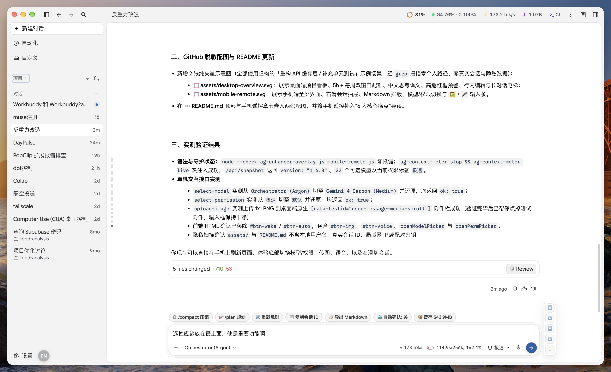
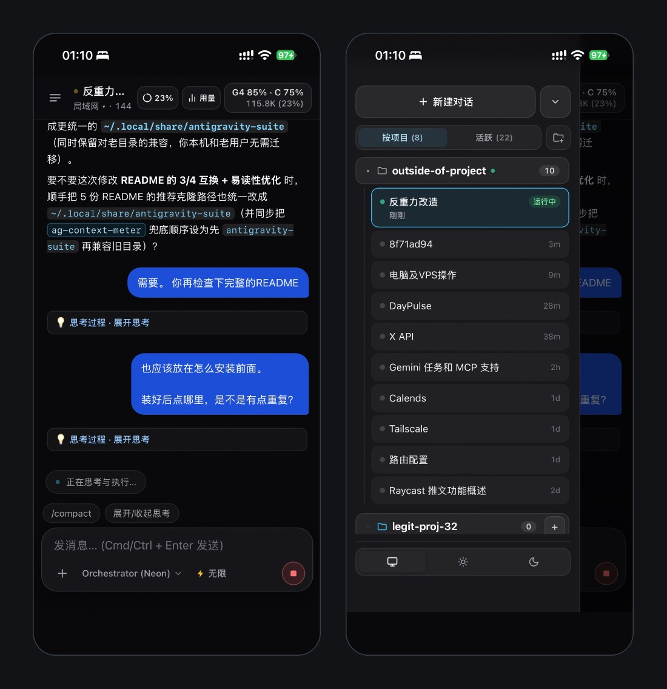
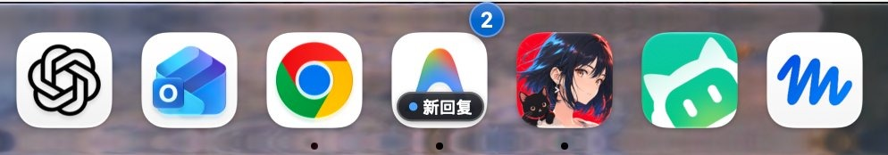

# Antigravity Suite

[简体中文](../README.md) · [English](README.en.md) · [日本語](README.ja.md) · [한국어](README.ko.md) · **Español**

> **Suite de mejoras y control remoto 100 % sin parches (Zero-Patch) para Google Antigravity en escritorio (macOS). Nunca modifica el paquete oficial de la aplicación ni la firma de Apple, no interfiere con las actualizaciones y se activa o desactiva al instante.**

<p align="center">
  
</p>

## Funciones principales

1. **🇨🇳 Cambio instantáneo entre chino simplificado e inglés (traducción local sin tokens)**:
   - Cambia al instante entre la interfaz en chino simplificado (con traducción en caché local sin consumo de cuota para bloques de pensamiento y títulos) y la interfaz original en inglés desde **`⚙️` → `🌐 Language & Appearance`**, sin reiniciar.
   - *Nota*: La interfaz integrada admite chino simplificado e inglés, mientras que los prompts rápidos personalizados pueden escribirse libremente en español o en cualquier idioma.
2. **📱 Control remoto ultrarrápido para móvil y escritorio (mucho más rápido que el oficial)**:
   - **Velocidad directa en red local y PWA ligera**: Conexión directa en **LAN** (misma red Wi-Fi o cableada) en milisegundos con selección automática de la ruta más rápida entre **LAN**, **Tailscale** (con gestión automática de `tailscale serve` HTTPS `https://<host>.ts.net` sin aviso de «No seguro» y bloqueo de degradación a HTTP), **Bonjour (`*.local`)** y un **túnel rápido de Cloudflare sin inicio de sesión por defecto (compatible con dominios propios)**, evitando la lentitud del relé oficial en la nube (configurable en tiempo real desde **`⚙️` → `📱 Remote`**). Al cambiar de chat solo cancela las lecturas pendientes de la página anterior sin interrumpir la IA en segundo plano, combinando carga diferida y compresión **`gzip`**.
   - **Espacio de trabajo completo**: Sesiones agrupadas por proyecto con insignias de no leídos y aprobaciones, **notificaciones Web Push sin dependencias** (aviso al completar o esperar aprobación con respaldo local) e **insignia de no leídos en el icono PWA** (contando estrictamente conversaciones completadas sin leer), creación remota de proyectos y vista previa de archivos/diffs/artefactos dentro del límite `$HOME`, **barra deslizable de prompts rápidos** sincronizada con el escritorio (conmutación **`⚡Send / ✎Insert`** y protección de borrador), cola de mensajes pendientes (enviar ahora / editar / retirar), subida de archivos e imágenes, tarjetas de confirmación interactivas (doble confirmación para comandos críticos), paneles superiores, 9 interruptores de visibilidad, aislamiento por pestaña, sincronización de apariencia **System / Light / Dark** y envío con `Cmd/Ctrl + Enter` protegido contra IME de Safari.

   <p align="center">
     
   </p>

3. **🔔 Alertas de estado y no leídos en el Dock de macOS (Insignia roja/azul + Cápsula, Zero-Patch)**:
   - **Todo a la vista sin cambiar de ventana**: Sin modificar `Antigravity.app` ni la firma de Apple. Refleja en tiempo real los puntos de no leídos de la barra lateral (deduplicados entre ventanas) sobre el icono del Dock con **números azul/rojo en la esquina** y una **cápsula translúcida (`Working` / `Unread` / `Approve` / `High Risk`)**, o cambia a **Badge Only** en **`⚙️` → `🌐 Language & Appearance`**.
   - **Centrado óptico y limpieza inteligente**: Sigue la ampliación al pasar el ratón por el Dock; al volver a la ventana limpia automáticamente los avisos azules normales y conserva las alertas rojas de aprobación hasta resolverlas. En el primer uso pulsa **Grant Access** para otorgar permiso de Accesibilidad en macOS (requiere Xcode Command Line Tools) y **Test Alert** para previsualizar.

   <p align="center">
     
   </p>

4. **⚡ Prompts rápidos y optimización en el compositor (`⚙️` → `⚡ Chat & Efficiency`)**:
   - **14 acciones rápidas recomendadas integradas** organizadas en 3 grupos por escenario (conversión a comandos nativos) junto con **10 plantillas populares en un clic**.
   - **`Insert` vs `⚡Send`**: **`Insert`** coloca el texto en el cuadro de entrada para añadir registros o contexto; **`⚡Send`** (`↵`) envía de inmediato. Protegido contra pérdida de borradores e inversión mediante **`⌘/Ctrl + clic`**, además de optimización con **`✨ Optimize` / `↩ Undo`** y sugerencias contextuales con **`Tab / →`**.
5. **🧰 Utilidades rápidas de escritorio**:
   - **`⌘1`–`⌘9`** (mantén `⌘` para ver índices) o **`⌘⇧[` / `⌘⇧]`** / **`⌃Tab`** para saltar entre conversaciones, barra flotante de navegación de mensajes y edición directa **`Edit` + `⌘S`** en paneles de vista previa (**`Done`** para refrescar).
   - **`>_ CLI`** para abrir con un clic la herramienta de línea de comandos `agy` en `Terminal`, `iTerm2`, `Ghostty`, `Warp`, `Alacritty`, `Kitty`, `WezTerm`, `Rex`, `tmux` o ruta personalizada, más **proxy local directo HTTP / SOCKS5 sin modo TUN global** (**`⚙️` → `🧰 Terminal & Network`**). Compatible con Antigravity **`2.32.x–2.34.0`** y gestores de Node `nvm`/`fnm`/`volta`/`asdf`/`mise`.
6. **📊 Monitor de contexto, autocompactación a 240K y cápsulas de cuota dual**:
   - Anillo superior en vivo, desglose de tokens, mapa de calor de 52 semanas, comparativa de costes API y cápsulas de cuota de 5 horas y semanal para **Gemini 4 / Claude** (`G4` / `C`). Los niveles de suscripción, región/divisa de facturación y pagos personalizados se configuran en **`⚙️` → `📊 Plan & Subscription`**.
   - Los clientes oficiales esperan hasta 512K tokens para compactar, lo que provoca bloqueos de 4–5 minutos cuando expira la caché más allá de 250K–330K; las alertas en tiempo real detectan caídas al 0 % (riesgo 328K) y la **autocompactación a 240K** (activa por defecto) envía `/compact` automáticamente cuando el chat queda libre (configurable en **`⚙️` → `⚡ Chat & Efficiency`**).
7. **🛡️ Bloqueo con marco rojo ante comandos peligrosos**:
   - Destaca con un marco rojo los comandos destructivos (`rm -rf`, `git reset --hard`, `git clean -f`, `git push`, `sudo`, `kill -9`, `DROP/DELETE`, `op item`) y detiene la ejecución para pedir aprobación manual incluso si la aceptación automática segura está activada en **`⚙️` → `⚡ Chat & Efficiency`**.
8. **🔄 Detección automática y actualización en un clic**:
   - Comprueba GitHub automáticamente en segundo plano; cuando hay una nueva versión, **`⚙️`** muestra un punto rojo para pulsar **Update Now** y aplicar la mejora al instante sin reiniciar Antigravity.

---

## 🚀 Instalación sin parches (macOS)

Requisitos: **macOS**, **Google Antigravity** (`2.32.x–2.34.0`) y **Node.js `22.4.0+`**.

```bash
git clone https://github.com/iamvicliu/antigravity-suite.git ~/.local/share/antigravity-suite
cd ~/.local/share/antigravity-suite
./scripts/setup-macos-cdp.sh
```

> Opciones: `--no-auto` omite el arranque automático (puedes ejecutar `ag-context-meter install-launcher` para crear un lanzador en `~/Applications`) y `--no-remote` desactiva el servidor remoto.
> **Windows / Linux**: Inicia Antigravity con `--remote-debugging-port=9222` y ejecuta `node cli.js live` desde el directorio clonado (`node cli.js status` para comprobar).

Añade `~/.local/bin` al `PATH` de tu shell y verifica la instalación:

```bash
echo 'export PATH="$HOME/.local/bin:$PATH"' >> ~/.zshrc
source ~/.zshrc
ag-context-meter status
```

> **Aviso en el primer uso (`v2.33.0+`)**: Las versiones recientes de Antigravity desactivan por defecto el puerto de depuración. Si tras instalar no aparecen `📱 Remote` (`📱远程`) y `⚙️`, **pulsa `⌘Q` para cerrar por completo y vuelve a abrir Antigravity una vez** (o ejecuta `ag-context-meter restart`).

---

## 🛠️ Comandos diarios y desinstalación completa

| Comando | Uso |
| :--- | :--- |
| `ag-context-meter status` | Comprueba los módulos activos, el servicio de arranque automático y la firma oficial intacta |
| `ag-context-meter remote` | Muestra enlaces de los 4 canales, estado del túnel, dispositivos conectados y QR (`--tunnel on\|off`, `--reset-token`, `--json`) |
| `ag-context-meter live` | Inyecta las mejoras al instante en la ventana abierta de Antigravity (`--no-remote` para desactivar el remoto) |
| `ag-context-meter restart` | Reinicia Antigravity (`v2.33.0+`) con depuración CDP activada y carga la suite |
| `ag-context-meter update` | Descarga la última versión y la aplica al instante sin reiniciar |
| `ag-context-meter stop` | Desactiva temporalmente la suite solo para la sesión actual |
| `ag-context-meter auto-off` / `auto-on` | Desactiva o vuelve a activar la carga automática al abrir Antigravity |
| `ag-context-meter install-launcher` | Crea la app opcional `~/Applications/Antigravity 增强启动器.app` para instalaciones con `--no-auto` |

**Desinstalación completa**: ejecuta `ag-context-meter auto-off` y elimina:
- `~/Library/LaunchAgents/com.$(id -un).ag-live-helper.plist`
- `~/Applications/Antigravity 增强启动器.app`
- `~/.local/bin/ag-context-meter`
- `~/.local/share/antigravity-suite` (y `~/.local/share/antigravity-context-viewer` si actualizaste desde una versión anterior)
- *Opcional*: borra cachés locales, códigos de emparejamiento y ajustes con `rm -rf ~/Library/Application\ Support/AntigravityContextMeter ~/.config/antigravity-context-meter`

---

## 🔒 Principios de seguridad

- **Aplicación oficial intacta**: Los comandos heredados de modificación de paquetes están deshabilitados; todas las funciones se cargan únicamente en memoria sin alterar binarios ni firmas de Apple.
- **Control de canales y código aleatorio de 48 caracteres**: Activa canales privados (`LAN` / `Tailscale` / `Bonjour`) y el túnel rápido de Cloudflare sin inicio de sesión (activable en **`⚙️` → `📱 Remote`** o desactivable con `--no-remote`). Los canales desactivados rechazan el acceso, cada solicitud verifica un código aleatorio de 48 caracteres renovable en cualquier momento y los tokens de túnel propio se guardan solo localmente (`0600`) en `remote-config.json`.
- **Límites de ruta**: La edición directa y el explorador de proyectos verifican rutas reales confinadas dentro de `$HOME` y los espacios de trabajo registrados, bloqueando directorios del sistema y credenciales (`.ssh`, `.gnupg`, `1Password`, `Antigravity.app`).

---

## 🧪 Pruebas y agradecimientos

```bash
npm run test:suite
```

Agradecimiento especial a los colaboradores principales [@hubo1989](https://github.com/hubo1989) y [@Shens](https://github.com/Shens) por sus mejoras en el emparejamiento QR, control remoto y experiencia de escritorio. Para solución de problemas detallada y créditos de proyectos de referencia, consulta el **[README en chino simplificado](../README.md)** o el **[README en inglés](README.en.md)**. Publicado bajo licencia [MIT License](../LICENSE).
