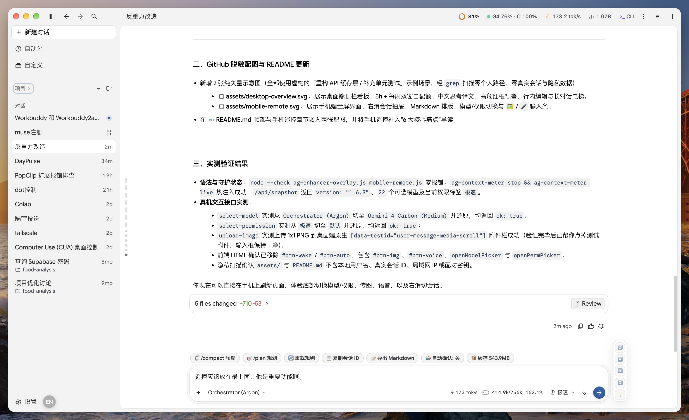
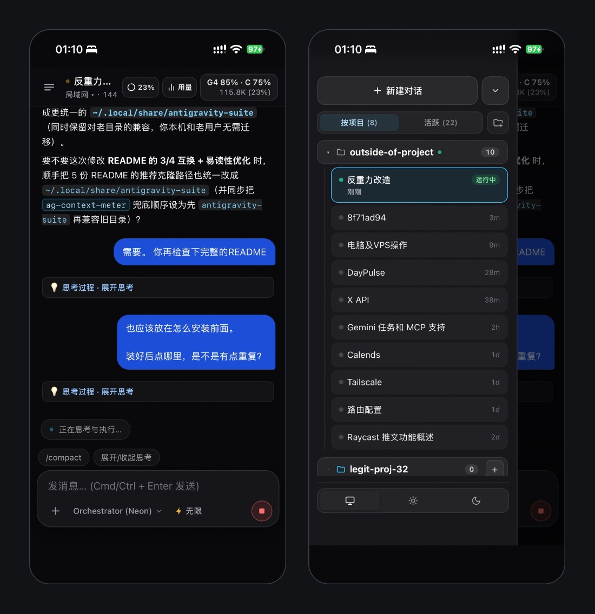
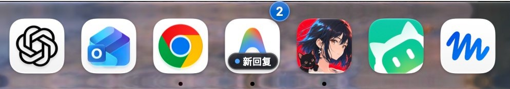

# Antigravity Suite

[简体中文](../README.md) · [English](README.en.md) · **日本語** · [한국어](README.ko.md) · [Español](README.es.md)

> **Google Antigravity デスクトップ版（macOS）向けの 100% ゼロ改変（Zero-Patch）拡張＆リモート操作スイート。公式アプリ本体や Apple 公式署名を一切変更せず、公式アップデートにも干渉せず、いつでも即時に切り替えられます。**

<p align="center">
  
</p>

## 主な機能

1. **🇨🇳 中国語／英語の即時切替（ゼロトークン思考翻訳）**：
   - **`⚙️` → `🌐 Language & Appearance`** から再起動なしで中国語 UI（思考プロセスとタイトルのローカルキャッシュ翻訳付き・トークン消費ゼロ）と英語 UI を即時に切り替えられます。
   - *補足*：内蔵 UI の表示言語は現在「簡体字中国語 / 英語」に対応していますが、カスタム定型プロンプトは日本語のまま自由に作成して利用できます。
2. **📱 超高速モバイル／PC リモート操作（公式より圧倒的に高速）**：
   - **ローカル直結＆軽量 PWA**：同一 Wi-Fi・有線内の **LAN** ミリ秒直結に加え、**Tailscale**、**Bonjour (`*.local`)**、**ログイン不要の Cloudflare 一時トンネル（独自ドメイン対応）** から最速ルートを自動選択し、公式クラウド中継の遅延を回避します（設定は **`⚙️` → `📱 Remote`** で即時変更可能）。会話切替時は旧ページの未完了読込のみをキャンセルするため、裏で動作中の AI タスクを中断しません。遅延履歴ロードと **`gzip`** 圧縮により全量履歴も快適にスクロールできます。
   - **多機能ワークスペース**：マルチプロジェクト切替（未読・承認バッジ付き）、`$HOME` 安全境界内での新規プロジェクト作成とファイル／差分／生成物プレビュー、デスクトップ側と同期する**横スクロール定型プロンプトバー**（**`⚡Send / ✎Insert`** 切替・下書き保護対応）、待機中メッセージ管理（即時送信・取り消し）、汎用ファイル＆画像アップロード、対話式確認カード（高リスク操作の二重確認）、上部ドロワー、9項目表示切替、タブごとの独立閲覧、System / Light / Dark 外観同期、IME 誤送信防止付き `Cmd/Ctrl + Enter` 送信に対応しています。
3. **⚡ 入力欄ショートカット＆プロンプト最適化（`⚙️` → `⚡ Chat & Efficiency`）**：
   - **14種のおすすめ内蔵コマンド**（シナリオ別に3グループ化・スラッシュ選択でネイティブコマンドピルへ変換）と、ワンクリックで追加できる **10種の人気テンプレート**を搭載。
   - **`Insert` vs `⚡Send`**：**`Insert`** はログや背景を追記してから送る入力欄への挿入、**`⚡Send`**（`↵` 表示）はワンクリック即送信。下書き保護と **`⌘/Ctrl + クリック`** 反転に対応し、さらに **`✨ Optimize` / `↩ Undo`** によるプロンプト整形や **`Tab / →`** による次の一手サジェストを備えています。
4. **🧰 デスクトップ便利ツール**：
   - **macOS Dock 未読＆ステータス通知**（**`⚙️` → `🌐 Language & Appearance`**・既定で有効）：公式アプリ無改変の透過オーバーレイで、Dock アイコン上に **「Status Capsule (Recommended)」**（Working / Unread / Approve / High Risk）または **「Badge Only」**（青・赤の段階別数字バッジ）を表示します。ウィンドウに戻ると通常の未読は自動消去され、赤色の承認バッジは承認されるまで残ります。初回利用時は同画面の **Grant Access** から macOS「アクセシビリティ」権限を許可し（初回コンパイルに Xcode Command Line Tools が必要）、**Test Alert** で表示をプレビューできます。
   - **`⌘1`〜`⌘9`**（`⌘` 長押しで番号表示）・**`⌘⇧[` / `⌘⇧]`**・**`⌃Tab`** による会話の即時切替、右側のフローティングメッセージナビゲーション、プレビュー欄でのインライン **`Edit` + `⌘S`** 編集（**`Done`** で再表示）。
   - **`>_ CLI`** による Antigravity CLI（`agy`）ワンクリック起動（`Terminal`、`iTerm2`、`Ghostty`、`Warp`、`Alacritty`、`Kitty`、`WezTerm`、`Rex`、`tmux` およびカスタムパス対応）と、**グローバル TUN 不要の HTTP / SOCKS5 ローカルプロキシ直結**（**`⚙️` → `🧰 Terminal & Network`**）。Antigravity **`2.32.x–2.34.0`** および `nvm`/`fnm`/`volta`/`asdf`/`mise` に対応しています。
5. **📊 コンテキスト監視・240K 自動圧縮・デュアル枠カプセル**：
   - 右上のリングメーターでコンテキスト消費量、52週ヒートマップ、API 換算コストを可視化し、**Gemini 4 / Claude** の 5時間＆週間残量カプセル（`G4` / `C`）を追跡します。プラン種別・決済地域／通貨・カスタム実支払額は **`⚙️` → `📊 Plan & Subscription`** で設定できます。
   - 公式クライアントは 512K まで自動圧縮を行わないため、250K〜330K 超過後にキャッシュ失効すると数分間の再計算フリーズが発生しがちです。本スイートは 0% キャッシュ脱落（328K リスク）を即時検知し、既定で有効な **240K 自動圧縮**によりアイドル時に自動で `/compact` を送信します（**`⚙️` → `⚡ Chat & Efficiency`** で切替可能）。
6. **🛡️ 危険コマンドの赤枠ブロック**：
   - `rm -rf`、`git reset --hard`、`git clean -f`、`git push`、`sudo`、`kill -9`、`DROP/DELETE`、`op item` などの高リスクコマンド実行時は、**`⚙️` → `⚡ Chat & Efficiency`** で安全自動承認を有効にしていても赤枠で強制一時停止し手動確認を求めます。
7. **🔄 更新の自動検知＆ワンクリック即時適用**：
   - GitHub の更新を自動確認し、新版がある場合は右上の **`⚙️`** に赤点が表示されます。**Update Now** をクリックするだけで再起動なしに最新版へ即更新されます。

<p align="center">
  
</p>
<p align="center">
  
</p>

---

## 🚀 導入手順（macOS・ゼロ改変 CDP 方式）

動作要件：**macOS**、**Google Antigravity**（`2.32.x–2.34.0`）、**Node.js `22.4.0+`**

```bash
git clone https://github.com/iamvicliu/antigravity-suite.git ~/.local/share/antigravity-suite
cd ~/.local/share/antigravity-suite
./scripts/setup-macos-cdp.sh
```

> オプション：`--no-auto`（自動起動を無効化、`ag-context-meter install-launcher` で `~/Applications` に独立起動アプリを作成可能）、`--no-remote`（リモートサーバーを無効化）。
> **Windows / Linux**：Antigravity を `--remote-debugging-port=9222` 付きで起動し、クローンしたディレクトリで `node cli.js live` を実行してください（`node cli.js status` で状態確認）。

`~/.local/bin` をシェルの `PATH` に追加して動作確認します：

```bash
echo 'export PATH="$HOME/.local/bin:$PATH"' >> ~/.zshrc
source ~/.zshrc
ag-context-meter status
```

> **初回起動時の注意（`v2.33.0+`）**：新しい Antigravity では既定でデバッグポートが無効になっています。インストール直後に `📱 Remote`（`📱远程`）や `⚙️` が表示されない場合は、**`⌘Q` で Antigravity を一度完全終了してから再起動**（または `ag-context-meter restart` を実行）してください。

---

## 🛠️ 日常コマンドとアンインストール

| コマンド | 役割 |
| :--- | :--- |
| `ag-context-meter status` | 有効モジュール、自動起動サービス、および公式署名の無改変状態を確認 |
| `ag-context-meter remote` | 4ルートのペアリング URL、トンネル状態、接続中端末、QR コードを表示（`--tunnel on\|off` / `--reset-token` / `--json` 対応） |
| `ag-context-meter live` | 起動中の Antigravity ウィンドウへ即時反映（`--no-remote` でリモート停止） |
| `ag-context-meter restart` | `v2.33.0+` 向けにデバッグポートを有効化して Antigravity を再起動・適用 |
| `ag-context-meter update` | 最新版を取得し、再起動なしで現在のウィンドウへ即時反映 |
| `ag-context-meter stop` | 今回のセッションのみ機能を一時解除して純正 UI へ戻す |
| `ag-context-meter auto-off` / `auto-on` | Antigravity 起動時の自動読み込みを無効化または再有効化 |
| `ag-context-meter install-launcher` | `--no-auto` 利用者向けに `~/Applications/Antigravity 增强启动器.app` を作成 |

**完全アンインストール**：`ag-context-meter auto-off` を実行後、以下を削除してください：
- `~/Library/LaunchAgents/com.$(id -un).ag-live-helper.plist`
- `~/Applications/Antigravity 增强启动器.app`
- `~/.local/bin/ag-context-meter`
- `~/.local/share/antigravity-suite`（旧版から移行した場合は `~/.local/share/antigravity-context-viewer` も削除）
- *任意*：翻訳キャッシュ・ペアリングコード・個人設定も消去する場合は `rm -rf ~/Library/Application\ Support/AntigravityContextMeter ~/.config/antigravity-context-meter`

---

## 🔒 セキュリティ原則

- **公式アプリの無改変**：旧来のパッケージ改変系コマンドは無効化されており、Apple 署名やバイナリを一切変更せずメモリ上のみで動作します。
- **チャンネル制限・48文字ランダムパスコード・個別セッション分離**：`LAN` / `Tailscale` / `Bonjour` および既定のログイン不要 Cloudflare 一時トンネルを制御し（**`⚙️` → `📱 Remote`** または `--no-remote` でいつでも切替可能）、未許可ルートは遮断されます。すべての通信は再発行可能な48文字のランダムパスコードを検証し、独自固定トンネルのトークンは権限 `0600` でローカルの `remote-config.json` のみに保存されます。
- **パス安全境界**：インラインファイル編集とリモートファイル閲覧は `$HOME` および登録済みワークスペース配下のみに厳格制限され、システム領域や認証情報ディレクトリ（`.ssh`、`.gnupg`、`1Password`、`Antigravity.app`）へのアクセスを遮断します。

---

## 🧪 テストとクレジット

```bash
npm run test:suite
```

QR ペアリング・リモート操作・UI 体験の最適化に貢献してくださった [@hubo1989](https://github.com/hubo1989) 氏・[@Shens](https://github.com/Shens) 氏に深く感謝します。詳しいトラブルシューティングや上流プロジェクト一覧は **[简体中文 README](../README.md)** および **[English README](README.en.md)** をご覧ください。[MIT License](../LICENSE) 下で公開されています。
