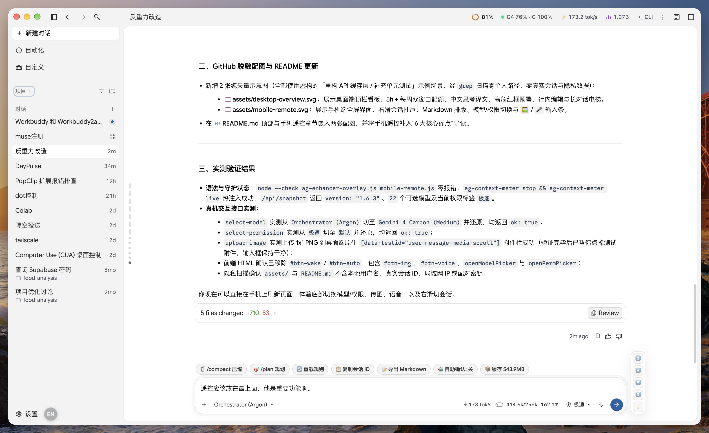
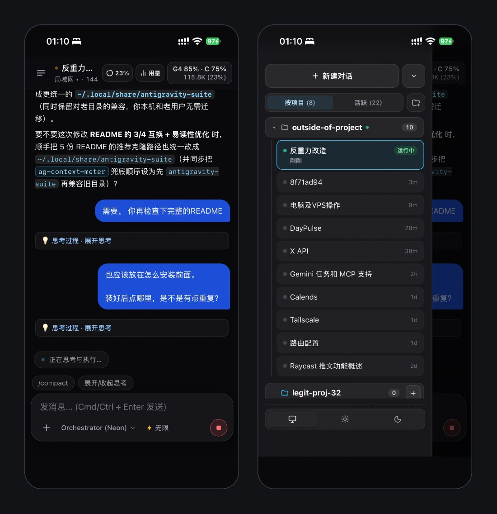
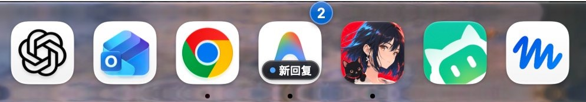

# Antigravity Suite

[简体中文](../README.md) · [English](README.en.md) · [日本語](README.ja.md) · **한국어** · [Español](README.es.md)

> **Google Antigravity 데스크톱(macOS)을 위한 100% 무변조(Zero-Patch) 확장 및 원격 제어 스위트입니다. 공식 앱 패키지나 Apple 공식 서명을 전혀 수정하지 않으며, 공식 업데이트와 충돌 없이 언제든 즉시 켜고 끌 수 있습니다.**

<p align="center">
  
</p>

## 핵심 기능

1. **🇨🇳 중국어/영어 즉시 전환 (제로 토큰 사고 번역)**:
   - **`⚙️` → `🌐 Language & Appearance`** 에서 재시작 없이 간체 중국어 UI(사고 과정 및 제목 로컬 캐시 번역 포함, 토큰 소모 없음)와 영어 원판 UI를 즉시 전환할 수 있습니다.
   - *참고*: 내장 UI 언어는 간체 중국어와 영어를 지원하며, 사용자 정의 단축 프롬프트는 한국어로 자유롭게 작성해 사용할 수 있습니다.
2. **📱 초고속 모바일·PC 원격 제어 (공식 대비 압도적 속도)**:
   - **로컬 직결 및 초경량 PWA**: 동일 Wi-Fi 및 유선 내 **LAN** 밀리초 직결을 비롯해 **Tailscale**(HTTPS 인증서 활성화 시 `tailscale serve`를 자동 구성해 `https://<host>.ts.net`를 우선 제공하고 PWA '안전하지 않음' 경고 및 HTTP 다운그레이드 차단), **Bonjour (`*.local`)**, **기본 로그인 없는 Cloudflare 임시 터널(고정 도메인 지원)** 중 가장 빠른 경로를 자동으로 선택해 공식 클라우드 중계 지연을 없앴습니다(**`⚙️` → `📱 Remote`** 에서 실시간 설정 가능). 대화 전환 시 이전 화면의 미완료 데이터 요청만 취소하므로 백그라운드 AI 작업이 중단되지 않으며, 지연 로딩과 **`gzip`** 압축으로 전체 대화 기록도 매끄럽게 탐색할 수 있습니다.
   - **풍부한 원격 워크스페이스**: 멀티 프로젝트 분류(읽지 않음/승인 배지), 무의존 **Web Push 백그라운드 알림**(완료·승인 대기 + 로컬 알림 폴백) 및 **PWA 앱 아이콘 읽지 않음 배지**(완료 후 미열람 대화만 엄격 집계), `$HOME` 안전 경계 내 원격 프로젝트 생성 및 파일·변경 diff·생성물 미리보기, 데스크톱과 동기화되는 **가로 스크롤 단축 명령 바**(**`⚡Send / ✎Insert`** 전환 및 초안 보호), 대기열 메시지 관리(즉시 전송/편집/철회), 일반 파일·이미지 업로드, 대화형 확인 카드(고위험 2단계 확인), 상단 드로어, 9개 화면 표시 토글, 브라우저 탭별 독립 탐색, System / Light / Dark 테마 동기화 및 오입력 방지 `Cmd/Ctrl + Enter` 전송을 지원합니다.

   <p align="center">
     
   </p>

3. **🔔 macOS Dock 읽지 않음 및 상태 알림 (숫자 배지 + 반투명 상태 캡슐, 무변조)**:
   - **다른 창에서 작업할 때도 한눈에 상태 파악**: 공식 앱 바이너리나 Apple 서명을 전혀 건드리지 않고, 여러 창의 사이드바 읽지 않음 점을 ID 중복 제거와 함께 Dock 아이콘 위로 실시간 표시합니다. **`⚙️` → `🌐 Language & Appearance`** 에서 **「Status Capsule (Recommended)」**(생성 중 / 새 답장 / 승인 대기 / 고위험 + 우측 상단 파란·빨간 숫자 배지) 또는 **「Badge Only」**(숫자 배지만)로 즉시 전환할 수 있습니다.
   - **호버 확대 추적 & 자동 해제**: 광학 정렬과 Dock 확대 애니메이션 추적을 지원하며, 창으로 돌아오면 일반 파란 읽지 않음은 자동 지워지고 빨간 승인·고위험 배지는 처리 전까지 유지됩니다. 최초 사용 시 **Grant Access** 로 macOS 손쉬운 사용(Accessibility) 권한을 허용하고(컴파일에 Xcode Command Line Tools 필요) **Test Alert** 로 바로 미리볼 수 있습니다.

   <p align="center">
     
   </p>

4. **⚡ 입력창 단축 명령 & 프롬프트 최적화 (`⚙️` → `⚡ Chat & Efficiency`)**:
   - **14종 추천 내장 단축 명령**(상황별 3그룹 구성, 슬래시 입력 시 네이티브 명령 알약으로 변환)과 원클릭 추가 가능한 **인기 템플릿 10종**을 제공합니다.
   - **`Insert` vs `⚡Send`**: **`Insert`** 는 오류 로그나 배경을 덧붙일 때 입력창에 텍스트만 채워주며, **`⚡Send`**(`↵` 표시)는 클릭 즉시 전송합니다. 초안 보호와 **`⌘/Ctrl + 클릭`** 전환을 지원하며, **`✨ Optimize` / `↩ Undo`** 프롬프트 다듬기 및 **`Tab / →`** 다음 단계 제안 기능도 제공합니다.
5. **🧰 데스크톱 편의 도구**:
   - **`⌘1`~`⌘9`**(`⌘` 길게 눌러 번호 표시) / **`⌘⇧[` / `⌘⇧]`** / **`⌃Tab`** 대화 즉시 전환, 플로팅 메시지 내비게이션, 미리보기 창 인라인 **`Edit` + `⌘S`** 편집(**`Done`** 클릭 시 새로고침).
   - **`>_ CLI`** 원클릭 Antigravity CLI(`agy`) 실행(`Terminal`, `iTerm2`, `Ghostty`, `Warp`, `Alacritty`, `Kitty`, `WezTerm`, `Rex`, `tmux` 및 사용자 지정 경로 지원)과 **전역 TUN 없는 HTTP / SOCKS5 로컬 프록시 직결**(**`⚙️` → `🧰 Terminal & Network`**). Antigravity **`2.32.x–2.34.0`** 및 `nvm`/`fnm`/`volta`/`asdf`/`mise` 환경을 지원합니다.
6. **📊 컨텍스트 모니터, 240K 자동 압축 & 듀얼 할당량 캡슐**:
   - 상단 링 미터로 현재 컨텍스트 점유율, 52주 히트맵, API 참고 비용을 확인하고 **Gemini 4 / Claude** 5시간 및 주간 한도(`G4` / `C`)를 추적합니다. 구독 요금제 세부 사양, 결제 지역/통화, 실제 결제 금액은 **`⚙️` → `📊 Plan & Subscription`** 에서 설정할 수 있습니다.
   - 공식 클라이언트는 512K에 도달해야 압축을 시작하므로 250K~330K 이상에서 캐시가 만료되면 몇 분씩 전체 재계산 멈춤이 발생하기 쉽습니다. 본 스위트는 0% 캐시 이탈(328K 위험)을 즉시 감지하며 기본 활성화된 **240K 자동 압축**으로 유휴 시 `/compact` 를 자동 실행합니다(**`⚙️` → `⚡ Chat & Efficiency`** 에서 제어).
7. **🛡️ 위험 명령 빨간 테두리 차단**:
   - `rm -rf`, `git reset --hard`, `git clean -f`, `git push`, `sudo`, `kill -9`, `DROP/DELETE`, `op item` 등 고위험 명령 실행 전에는 **`⚙️` → `⚡ Chat & Efficiency`** 의 안전 자동 승인이 켜져 있어도 빨간 경고 테두리로 멈추고 수동 승인을 요구합니다.
8. **🔄 업데이트 자동 감지 & 원클릭 즉시 적용**:
   - GitHub 새 버전을 자동 확인해 우측 상단 **`⚙️`** 에 빨간 점을 표시하며, **Update Now** 를 누르면 Antigravity 재시작 없이 즉시 내려받아 적용됩니다.

---

## 🚀 무변조 설치 방법 (macOS)

필요 환경: **macOS**, **Google Antigravity**(`2.32.x–2.34.0`), **Node.js `22.4.0+`**

```bash
git clone https://github.com/iamvicliu/antigravity-suite.git ~/.local/share/antigravity-suite
cd ~/.local/share/antigravity-suite
./scripts/setup-macos-cdp.sh
```

> 선택 옵션: `--no-auto`(자동 실행 제외, `ag-context-meter install-launcher` 로 `~/Applications` 에 독립 실행 앱 생성 가능), `--no-remote`(원격 서버 비활성화).
> **Windows / Linux**: `--remote-debugging-port=9222` 옵션으로 Antigravity를 실행한 뒤 클론한 폴더에서 `node cli.js live` 를 실행하세요(`node cli.js status` 로 확인).

터미널 `PATH` 에 `~/.local/bin` 을 추가한 뒤 동작을 확인합니다.

```bash
echo 'export PATH="$HOME/.local/bin:$PATH"' >> ~/.zshrc
source ~/.zshrc
ag-context-meter status
```

> **첫 설치 안내 (`v2.33.0+`)**: 최신 Antigravity는 기본적으로 디버깅 포트가 비활성화되어 있습니다. 설치 직후 `📱 Remote` (`📱远程`) 및 `⚙️` 가 보이지 않으면 **`⌘Q` 로 Antigravity를 완전히 종료한 뒤 다시 실행**(또는 `ag-context-meter restart` 실행)하면 즉시 적용됩니다.

---

## 🛠️ 일상 명령어 및 완전 제거

| 명령어 | 설명 |
| :--- | :--- |
| `ag-context-meter status` | 활성 모듈, 자동 실행 데몬 상태 및 공식 앱 무결성 확인 |
| `ag-context-meter remote` | 4채널 페어링 주소, 터널 상태, 연결 기기 및 QR 코드 출력 (`--tunnel on\|off` / `--reset-token` / `--json` 지원) |
| `ag-context-meter live` | 실행 중인 Antigravity 창에 즉시 적용 (`--no-remote` 로 원격 기능 끄기) |
| `ag-context-meter restart` | `v2.33.0+` 환경에서 디버깅 포트를 열어 Antigravity 안전 재시작 및 적용 |
| `ag-context-meter update` | 최신 업데이트를 내려받아 재시작 없이 현재 창에 즉시 반영 |
| `ag-context-meter stop` | 이번 세션 동안만 확장 기능을 일시 해제 |
| `ag-context-meter auto-off` / `auto-on` | Antigravity 실행 시 자동 적용 비활성화 또는 재활성화 |
| `ag-context-meter install-launcher` | `--no-auto` 사용자를 위해 `~/Applications/Antigravity 增强启动器.app` 생성 |

**완전 제거 방법**: `ag-context-meter auto-off` 실행 후 아래 항목을 삭제하세요.
- `~/Library/LaunchAgents/com.$(id -un).ag-live-helper.plist`
- `~/Applications/Antigravity 增强启动器.app`
- `~/.local/bin/ag-context-meter`
- `~/.local/share/antigravity-suite` (구버전에서 업그레이드한 경우 `~/.local/share/antigravity-context-viewer` 포함)
- *선택*: 번역 캐시, 페어링 암호, 개인 설정까지 모두 지우려면 `rm -rf ~/Library/Application\ Support/AntigravityContextMeter ~/.config/antigravity-context-meter`

---

## 🔒 보안 원칙

- **공식 앱 무변조**: 기존 패키지 변조 명령은 비활성화되어 있으며, Apple 서명이나 앱 바이너리를 수정하지 않고 메모리 상에서만 실행됩니다.
- **채널 접근 제어 및 48자리 랜덤 암호**: `LAN` / `Tailscale` / `Bonjour` 및 기본 로그인 없는 Cloudflare 임시 터널을 제어하며(**`⚙️` → `📱 Remote`** 또는 `--no-remote` 로 언제든 전환), 비활성화된 채널 접근은 차단됩니다. 모든 요청은 언제든 재설정 가능한 48자리 랜덤 페어링 암호를 검증하며, 고정 터널 토큰은 `0600` 권한의 로컬 `remote-config.json` 에만 저장됩니다.
- **경로 접근 제한**: 인라인 파일 편집 및 원격 파일 탐색은 `$HOME` 과 등록된 워크스페이스 내부로만 엄격히 제한되며, 시스템 디렉터리 및 인증 저장소(`.ssh`, `.gnupg`, `1Password`, `Antigravity.app`) 접근을 차단합니다.

---

## 🧪 테스트 및 기여자

```bash
npm run test:suite
```

QR 페어링, 원격 제어 및 사용 경험 개선에 기여한 [@hubo1989](https://github.com/hubo1989), [@Shens](https://github.com/Shens) 님께 감사드립니다. 상세한 문제 해결 및 업스트림 프로젝트 안내는 **[简体中文 README](../README.md)** 와 **[English README](README.en.md)** 를 참고하세요. [MIT License](../LICENSE) 를 따릅니다.
